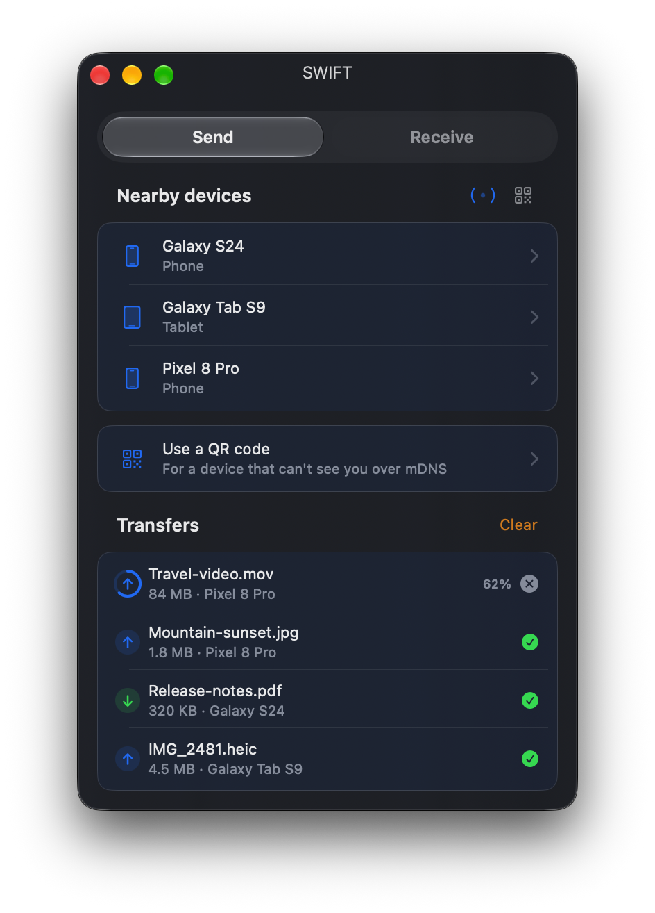
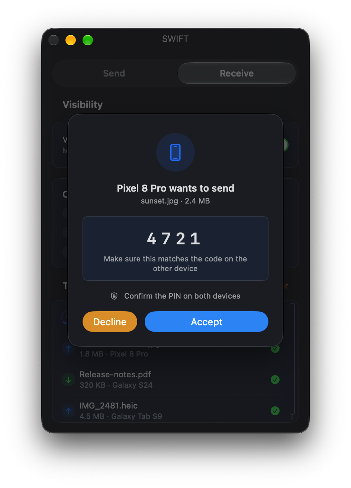

<h1 align="center">SWIFT</h1>

<p align="center">
  Send a file from a Mac to an Android phone, or the other way,<br>
  on the same Wi-Fi. Pair once. After that, it stays connected.
</p>

<p align="center">
  
  
  
  
</p>

<p align="center">
  
  &nbsp;&nbsp;
  
</p>

---

Your phone already shares with Quick Share. Your Mac shares with AirDrop. Those two do not see each other, so people send the file through a chat app and the photo gets smaller. SWIFT is the Mac app that speaks Quick Share, so the file stays full size and stays on your Wi-Fi.

Pair the Android phone once. After that it stays connected. You do not pair again for the next file, and you do not pair again for the next copy.

An iPhone does not install anything. The Android phone shows a QR code. Safari opens it. The photo is the original file.

Install it from source with one command, or download the ready-made files from the [latest release](https://github.com/rian1717/SWIFT/releases/latest). See [Install](#install).

## Features

- **Send** — pick a device and drag files onto it, or drop them on a device row
- **Finder Share extension** — send selected files without opening the main window
- **Receive** — flip visibility on and your Mac appears on the phone
- **Text and links** — saved to your downloads folder as files, never opened
- **PIN verification** — a 4-digit code on both screens before anything moves
- **Explicit consent** — every transfer requires PIN verification and approval, on the Mac and in the Android app, including devices under My devices
- **QR code** — reach a phone that can't discover you
- **Menu-bar app** — keeps running with the window closed, and opens by itself at login (turn it off in Settings → Open at login)
- **Command-line API** — drive it from scripts or an agent (off by default)
- **Clipboard** — pair once. After that, copy on the Android phone and press ⌘V on the Mac. iPhone copies already paste through Apple Handoff.

## Install

SWIFT has two parts: the **Mac app** and the **Android app**. Install both for
clipboard sync. Sending files to a phone that has Quick Share needs only the
Mac app.

You need a Mac on **macOS 26 or later**, an Android phone (Android 8 or later),
and both on the same Wi-Fi.

### Mac app

**Option 1. Build it yourself (one command).** This needs
[Xcode 26 or later](https://developer.apple.com/xcode/) from the App Store.
Open Xcode once so it finishes setting up, then run this in Terminal:

```bash
git clone https://github.com/rian1717/SWIFT.git
cd SWIFT
SWIFT/Packaging/install.sh
```

It checks your Mac, builds the app (about a minute), puts **SWIFT** in
**Applications** and opens it. An app you build yourself opens without a macOS
warning. When macOS asks about **Local Network**, choose **Allow**.

If it stops, it prints the reason. The usual two:
`sudo xcodebuild -license accept`, and
`sudo xcode-select -s /Applications/Xcode.app`.

**Option 2. Download it.** Get `SWIFT-mac.zip` from the
[latest release](https://github.com/rian1717/SWIFT/releases/latest), unzip it
and move **SWIFT** into **Applications**. This build is not notarized, so
macOS says it cannot check the developer. Control-click **SWIFT**, choose
**Open**, then **Open** again. If macOS says the app is damaged, run:

```bash
xattr -dr com.apple.quarantine /Applications/SWIFT.app
```

### Android app

**Option 1. Download it.** Get `SWIFT-android.apk` from the
[latest release](https://github.com/rian1717/SWIFT/releases/latest), copy it to
the phone and open it. Allow installation from that source if Android asks.

**Option 2. Build it yourself.** This needs [Android Studio](https://developer.android.com/studio)
(it brings Java 17 and the Android SDK). Then:

```bash
cd SWIFT/android
export ANDROID_HOME="$HOME/Library/Android/sdk"
export JAVA_HOME="/Applications/Android Studio.app/Contents/jbr/Contents/Home"
./gradlew assembleDebug
```

The app is `app/build/outputs/apk/debug/app-debug.apk`. Copy it to the phone,
or with the phone connected by USB debugging run
`~/Library/Android/sdk/platform-tools/adb install -r app/build/outputs/apk/debug/app-debug.apk`.

If Play Protect blocks the install and the only button is **OK**, open the Play
Store, tap your profile, open **Play Protect**, tap the gear, and turn off
**Improve harmful app detection**. If that switch is missing, turn off **Scan
apps with Play Protect**. Install the app, then turn the switch back on.

### First run

Open SWIFT on the Mac and on the phone. The phone shows the Mac. Tap the Mac,
then tap **Allow** on the Mac. That pair happens once. After that, the phone
stays connected.

## Using it

Both devices stay on the same Wi-Fi. Received files land in `~/Downloads`.
Change that folder in Settings.

**Send to a phone that is already listed.** On the Send tab, drop the file on
that phone. Accept on the phone. The four-digit PIN on both screens should
match. With the SWIFT Android app, the phone shows a pop-up with the PIN and
**Accept** or **Decline**. Nothing is saved until you accept, and no answer
within 60 seconds counts as a decline. Keep notifications on for SWIFT, or
every transfer is declined. When the file arrives, tap the pop-up to open it.

**Send to a phone that is not listed.** This is the normal path for a Samsung,
and for any phone that does not appear. Tap **Use a QR code**, then drop the
file. The QR code appears on its own. Scan it with the phone's camera or Quick
Share, then accept. There is no second tap to reveal the code.

**Receive from the phone.** Open the Receive tab and turn visibility on. On the
phone, share the file with Quick Share and choose the Mac. Match the PIN and
accept. The phone's Quick Share settings page does not list devices. Start from
the share sheet in Gallery or Files instead.

**Copy on the phone, paste on the Mac.** An iPhone does not use this. iPhone
copies already paste through Apple Handoff when both devices use the same
Apple ID. For Android:

1. On the Mac, open **SWIFT → Settings…**. **Paste phone copies here** is on by default. Leave the QR code and the 8-digit code on screen.
2. Install the Android file from the [latest release](https://github.com/rian1717/SWIFT/releases/latest). It is `SWIFT-android.apk`. It is not on the Play Store. If Play Protect says the app is blocked and the only button is **OK**, open the Play Store, tap your profile, open **Play Protect**, tap the gear, and turn off **Improve harmful app detection**. If that switch is missing, turn off **Scan apps with Play Protect**. Install the app, then turn the switch back on.
3. On the phone, tap **Find Mac**, then tap your Mac. The Mac asks you to tap **Allow** once. Or scan the Mac's QR code, or paste the pairing link (**Copy pairing link** in the Mac's Settings), or type the 8-digit code into the box and tap **Pair**. After that one pair, the phone stays connected, including after you remove it and pair it again.
4. Tap **Turn on clipboard access**. Android blocks this for apps that do not come from the Play Store, so the first time takes a few extra taps:
   1. End any phone call first. Android can refuse this permission during a call.
   2. In **Accessibility → Downloaded apps**, tap **SWIFT** and try to turn it on. Android shows **Restricted setting** or **App was denied access**. Tap **Close** or **OK**. This step matters, because the option in the next step appears only after Android has shown that message once.
   3. Open **Settings → Apps → SWIFT**, tap the three dots in the top corner, and choose **Allow restricted settings**. Confirm with your fingerprint or PIN.
   4. Go back to **Accessibility → Downloaded apps → SWIFT** and turn it on.

   This is needed only for clipboard. Sending files works without it. Some Samsung phones hide the three-dot menu. On those, look for **Allow restricted settings** at the bottom of the app's info page.
5. Tap **Allow this phone to keep SWIFT running**. On a Xiaomi phone that is Autostart. On a Samsung phone, keep SWIFT out of sleeping apps.
6. Copy text, a picture, or a file on the phone, then press **⌘V** on the Mac.

| | |
|---|---|
| `⌘1` / `⌘2` | Send / Receive |
| `⇧⌘V` | Toggle visibility |
| `⇧⌘O` | Open downloads folder |
| `⌃⌥←` / `⌃⌥→` | Snap window to screen edge |
| `⌘⌥I` | Build info |

## If your phone doesn't see your Mac

Usually this isn't a bug. Android discovers nearby devices by listening for
Bluetooth LE advertisements, and **macOS provides no API to emit them**. Nothing
in this app can fix that — it's a platform limitation, not an oversight.

In practice that means Mac → phone is the reliable direction, and phone → Mac
needs a hand:

- Make sure both devices are on the **same Wi-Fi network** — not one on 5 GHz
  and one on a guest SSID.
- Check the router isn't running **AP isolation** (often called "client
  isolation"), which blocks devices from seeing each other.
- Turn off any **VPN** on either device; most capture the traffic discovery needs.
- Still nothing? **Use the QR code.** It's the designed answer to this, not a
  workaround — scanning it skips discovery entirely.

### Clipboard pairing: the phone can't find the Mac

- Open SWIFT on the Mac and keep it running. **Paste phone copies here** must be on (it is by default).
- If macOS asks **Do you want the application "SWIFT" to accept incoming network connections?**, choose **Allow**. If you chose Don't Allow, open **System Settings → Network → Firewall → Options**, find SWIFT and set it to **Allow incoming connections**.
- Choose **Allow** when macOS asks for **Local Network** access. You can change it later in **System Settings → Privacy & Security → Local Network**.
- On the phone, type the 8 digits from the Mac's Settings into the box and tap **Pair**. This finds the Mac even when the list stays empty.
- Only one copy of SWIFT can run at a time. If you built it yourself, quit the other copy first.

## Security

Every transfer shows a **4-digit PIN on both screens** before any bytes move.
Matching it is what proves you're talking to the device you think you are.

Quick Share as implemented here exposes *no verifiable device identity*: UKEY2
keys are generated fresh for every handshake, and the certificate frames that
would carry a persistent identity aren't in the specification this is built
from. The only thing a sender proves is the name it chose to advertise.

SWIFT therefore never trusts a device name or automatically accepts native
Quick Share traffic. Verify the PIN on both screens for every transfer.

Clipboard copies from the Android app are **encrypted with a key only that
phone and this Mac know**. Pairing works the key out on both sides; the key and
the 8-digit code never cross the network. Each copy is numbered, so an old one
cannot be sent again, and removing a phone deletes its key. A pairing link
always asks before it pairs.

Received links are **saved as files, never opened**. To report a security issue, see **[docs/SECURITY.md](docs/SECURITY.md)**.

## Command line

SWIFT can host a small JSON API on `127.0.0.1:47821` for scripting and
automation. It is **off by default** — enable it in *Settings → Services*.

> While it's on, anything running under your account can ask SWIFT to send any
> file it can read to a nearby device. That's the point of the feature, and the
> reason it's opt-in.

```bash
ln -s "$(pwd)/SWIFT/Packaging/swiftapp" /usr/local/bin/swiftapp

swiftapp list                                   # devices currently visible
swiftapp send ~/photo.jpg --to "Pixel 8 Pro"    # blocks; exit 0 on success
swiftapp status --json                          # machine-readable
```

Requests are authenticated with a token in `~/.config/swift/token`. Full
endpoint reference: **[docs/API.md](docs/API.md)**.

## How it works

```
Views (SwiftUI)  ──observe──▶  AppModel  ──▶  SWIFTService
                                                     │
                                          ┌──────────┴──────────┐
                                     MockService          SWIFTEngine
                              (SWIFT_MOCK=1)                 │
                                                    ┌───────────┴───────────┐
                                               Discovery              Transport
                                            mDNS · QR · TXT      framing · sessions
                                                                        │
                                                             Crypto ─── Wire
                                                            UKEY2 P-256  protobuf
```

`Sources/SWIFTCore/` is the protocol; `Sources/SWIFTApp/` is the app.
The seam between them is one protocol (`SWIFTService`), which is also what
makes the mock engine possible.

The whole thing is Swift 6 language mode: the transport runs on actors, the app
on the main actor, and the compiler checks the boundary rather than convention.

The wire format is hand-written rather than generated — only a small fraction of
the schema's messages are ever exchanged. Each is checked byte-identical against
a reference encoder, and the parsers that face the network are tested against
truncation, bit-flips, and random input.

See **[docs/ARCHITECTURE.md](docs/ARCHITECTURE.md)** for the design and the
protocol details worth knowing.

## Build and develop

```bash
cd SWIFT
Packaging/build-app.sh            # build only
open build/SWIFT.app
Packaging/install.sh              # build and install into Applications
```

The packaging step matters: real networking needs a proper `.app` bundle so
macOS will grant local-network access. A bare `swift run` binary can't get it.

```bash
cd SWIFT
swift test                        # unit + protocol tests
swift test --sanitize=thread      # concurrency
SWIFT_MOCK=1 swift run SWIFT      # UI work without a phone
```

`SWIFT_MOCK=1` runs a simulated engine that drives every UI state — devices, PINs,
progress, completion — with no network at all. The screenshots above were taken
with it.

`SWIFT/Packaging/make-dmg.sh` builds the app and wraps it in a disk image, which is
how releases are cut.

## Project documents

[Changelog](docs/CHANGELOG.md) · [Contributing](docs/CONTRIBUTING.md) · [Security](docs/SECURITY.md) · [Architecture](docs/ARCHITECTURE.md) · [API](docs/API.md) · [Troubleshooting](docs/TROUBLESHOOTING.md)

## Credits

Quick Share is undocumented. The protocol was reverse-engineered and specified
by **@grishka**, published at
**[grishka/NearDrop](https://github.com/grishka/NearDrop)** and released into
the public domain.

The implementation foundation and protocol provenance are documented in
**[ATTRIBUTION.md](docs/ATTRIBUTION.md)** and **[NOTICE](NOTICE)**.

Not affiliated with or endorsed by Google. "Quick Share" and "Nearby Share" are
their trademarks.

## License

[Apache-2.0](LICENSE).
