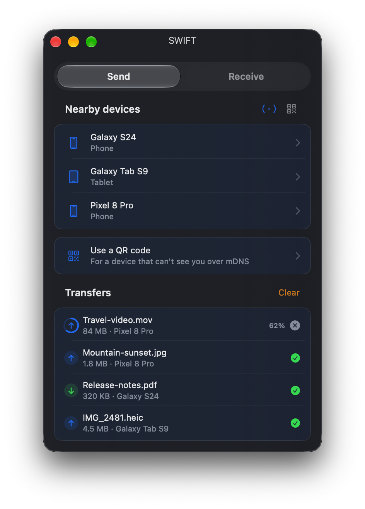
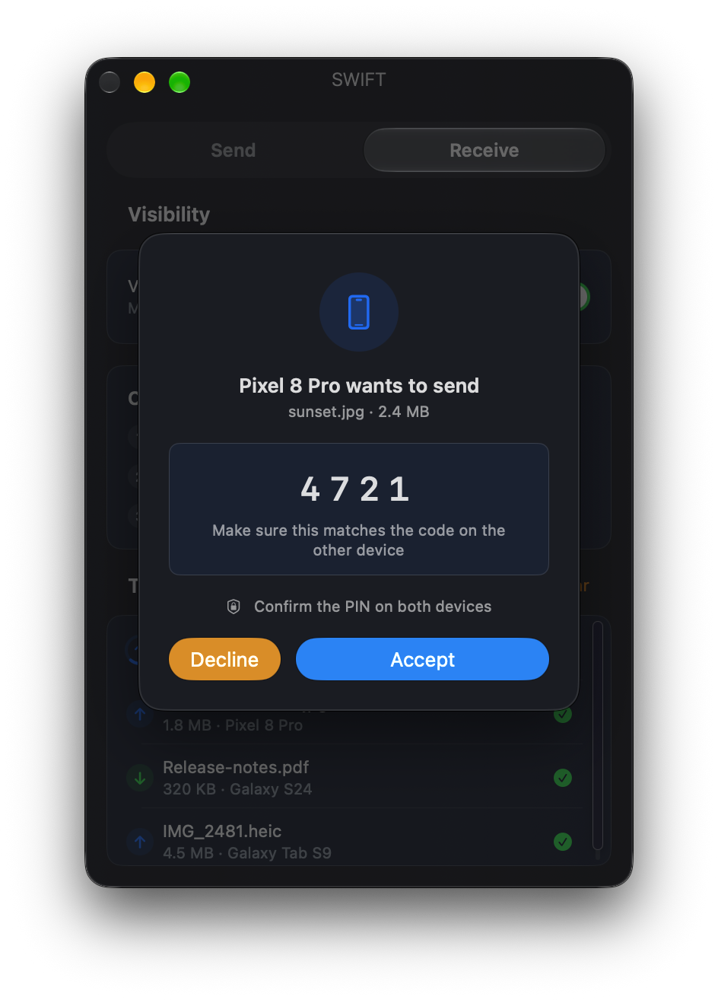

<h1 align="center">SWIFT</h1>

<p align="center">
  <b>Your Mac, your Android phone and your iPhone, finally talking to each other.</b><br>
  Files, photos and copy-paste over your own Wi-Fi. Full quality. No cable, no account, no cloud.
</p>

<p align="center">
  <a href="https://github.com/rian1717/SWIFT/releases/latest/download/SWIFT-mac.zip"></a>
  &nbsp;
  <a href="https://github.com/rian1717/SWIFT/releases/latest/download/SWIFT-android.apk"></a>
</p>

<p align="center">
  
  
  
  
</p>

<p align="center">
  
  &nbsp;&nbsp;
  
</p>

---

Your Android phone shares with Quick Share. Your Mac shares with AirDrop. They can't see each other, so people end up emailing photos to themselves or sending them through a chat app that shrinks them. **SWIFT fixes that.** The Mac app speaks Quick Share, the Android app adds clipboard sync, and an iPhone joins with a QR code, with nothing to install.

## What it does

| | |
|---|---|
| 📋 **Copy on Android, paste on Mac** | Copy text, a link, a picture or a file on the phone, then press **⌘V** on the Mac. |
| 📁 **Files both ways, Android ⇄ Mac** | Photos, videos and documents at full quality over Wi-Fi, with a 4-digit PIN on both screens. |
| 📱 **Android → iPhone** | Scan one QR code with the iPhone camera, tap **Save all to Photos**. Up to 100 photos per tap, as the original files. |
| 🔁 **iPhone → Android** | On the same page, tap **Send to Android**. The photos land in the phone's gallery. |
| ↗️ **Share from any app** | Pick photos in Google Photos or any app, tap **Share → SWIFT**. |
| 🟢 **Live status** | The Android app shows whether your Mac is really reachable right now. |

Pair the phone and the Mac once. After that they stay connected, with no pairing for the next file or the next copy.

## Download and install

You need a Mac on **macOS 26 or later**, an Android phone on **Android 8 or later**, and both on the **same Wi-Fi**. The iPhone needs nothing installed.

### 1. Mac

1. Download **[SWIFT-mac.zip](https://github.com/rian1717/SWIFT/releases/latest/download/SWIFT-mac.zip)**, unzip it and move **SWIFT** into **Applications**.
2. The app isn't notarized yet, so the first time, **Control-click SWIFT → Open → Open**.
   If macOS says the app is damaged, run this once in Terminal:
   ```bash
   xattr -dr com.apple.quarantine /Applications/SWIFT.app
   ```
3. When macOS asks about **Local Network** or **incoming connections**, choose **Allow**.

### 2. Android

1. Download **[SWIFT-android.apk](https://github.com/rian1717/SWIFT/releases/latest/download/SWIFT-android.apk)** on the phone and open it. Allow installs from that source if Android asks.
2. Open SWIFT, tap your Mac, then tap **Allow** on the Mac. Done: that pairing happens once.

<details>
<summary><b>Play Protect blocks the install</b></summary>

If the only button is **OK**: open the Play Store, tap your profile → **Play Protect** → gear icon, and turn off **Improve harmful app detection** (or **Scan apps with Play Protect** if that switch is missing). Install SWIFT, then turn the switch back on.
</details>

### 3. Turn on copy-paste (optional)

Sending files works straight away. Clipboard sync needs one Android permission, which Android hides for apps that don't come from the Play Store:

<details>
<summary><b>Show the steps</b></summary>

1. In SWIFT on the phone, tap **Turn on** next to **Clipboard access**. End any phone call first, because Android can refuse this permission during a call.
2. In **Accessibility → Downloaded apps → SWIFT**, try to turn it on. Android shows **Restricted setting**. Tap **OK**. This step is needed, because the next option only appears after that message.
3. Open **Settings → Apps → SWIFT**, tap **⋮** in the top corner, then **Allow restricted settings**, and confirm.
   On some Samsung phones the option is at the bottom of the app's info page.
4. Go back to **Accessibility → Downloaded apps → SWIFT** and turn it on.
5. Tap **Allow** next to **Keep SWIFT running**. On Xiaomi this is called Autostart. On Samsung, keep SWIFT out of sleeping apps.

Now copy something on the phone and press **⌘V** on the Mac.
</details>

## How to use it

- **Mac → phone:** open SWIFT on the Mac, drop a file on your phone in the **Send** tab, and accept on the phone after checking that the PINs match. If your phone isn't listed (common on Samsung), tap **Use a QR code**, then scan it with the phone.
- **Phone → Mac:** in SWIFT on the Mac, open **Receive** and turn visibility on. On the phone, **Share → Quick Share →** your Mac, check the PIN, and accept.
- **Phone → iPhone:** in the Android app, open the **iPhone** tab and add photos, or share them to SWIFT from any app. Scan the code with the iPhone camera, then tap **Save all to Photos**. Safari warns once, because the page comes from the phone next to you: tap **Show Details → visit this website**.
- **iPhone → phone:** on that same page, tap **Send to Android**.

Received files on the Mac go to `~/Downloads`. You can change the folder in Settings.

## Privacy and security

- **Nothing leaves your Wi-Fi.** There's no account, no cloud and no server, and SWIFT collects no analytics.
- **You approve every transfer**, after checking that the same 4-digit PIN shows on both screens.
- **Copies are encrypted** with a key that only your phone and your Mac know. The key never crosses the network, and an old copy can't be replayed.
- **Received links are saved as files, never opened.**

To report a security issue, see [SECURITY.md](docs/SECURITY.md).

## Trouble?

- **The phone doesn't see the Mac:** put both on the same Wi-Fi (not a guest network), turn off any VPN, and use the **QR code**. It skips discovery entirely. macOS can't send the Bluetooth signal Android normally uses to find devices, so Mac → phone is the more reliable direction.
- **The iPhone page won't open:** the phone and the iPhone must be on the same Wi-Fi, and the code must show a `192.168…` address.

More answers are in **[Troubleshooting](docs/TROUBLESHOOTING.md)**.

## For developers

SWIFT is native and dependency-free:
- **Mac:** Swift 6 and SwiftUI. The Quick Share protocol is implemented on Foundation, Network and CryptoKit.
- **Android:** Kotlin, no third-party libraries.
- **iPhone:** a web page served by the phone itself.

**[Architecture](docs/ARCHITECTURE.md)** explains how the parts fit together.

```bash
git clone https://github.com/rian1717/SWIFT.git && cd SWIFT

# Mac app (needs Xcode 26+): builds and installs into Applications
SWIFT/Packaging/install.sh

# Mac tests, and the UI with a simulated phone
cd SWIFT && swift test && SWIFT_MOCK=1 swift run SWIFT

# Android app (needs Android Studio for Java 17 and the SDK)
cd android && ./gradlew assembleDebug testDebugUnitTest
```

A local JSON API for scripts and automation is **off by default**. See [API.md](docs/API.md).

[Changelog](docs/CHANGELOG.md) · [Architecture](docs/ARCHITECTURE.md) · [Troubleshooting](docs/TROUBLESHOOTING.md) · [Contributing](docs/CONTRIBUTING.md) · [Security](docs/SECURITY.md) · [API](docs/API.md)

## Credits

Quick Share is undocumented. The protocol was reverse-engineered and specified by **@grishka** in **[grishka/NearDrop](https://github.com/grishka/NearDrop)**, released into the public domain. Provenance is documented in [ATTRIBUTION.md](docs/ATTRIBUTION.md) and [NOTICE](NOTICE).

SWIFT is not affiliated with or endorsed by Google or Apple. "Quick Share" is a trademark of Google LLC. "Mac", "iPhone" and "AirDrop" are trademarks of Apple Inc.

## License

[Apache-2.0](LICENSE). Free to use, change and share.
